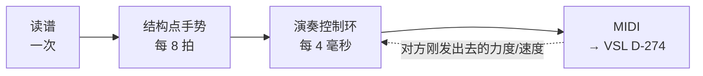
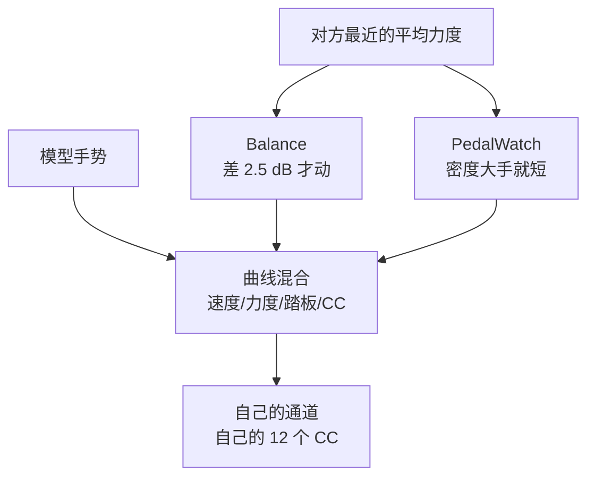

# 两个 AI，一架 D-274，没有指挥

你给的谱子就是全部音符。模型做的事只有一件：**决定怎么演奏，以及听见对方之后怎么改自己**。
难点不在"让模型写音乐"，在于"让模型的想法在 4 毫秒里变成声音"。

## 一条时间线上有三个尺度



读谱是一次性的，可以慢；手势是每 8 拍一次，可以迟到 220 毫秒，迟到就丢；控制环必须每 4 毫秒转一圈，永远不掉。

## 为什么不再是"一小节下一条命令"

模型往返 300–1800 毫秒，而 84 BPM 一拍只有 714 毫秒。等它回来，音符早该响了。
于是决策被拆开：模型只给方向，本地环给每一拍的执行。

| 层 | 谁 | 时间尺度 | 掉了怎么办 |
| --- | --- | --- | --- |
| 结构点手势 | 模型 A / B | 8 拍 | 220 ms 没回来就丢弃 |
| 演奏控制环 | 本地线程 | 4 ms | 不会掉 |

## 两条时钟，互相锁定

每个声部有自己的拍点、速度、漂移。A 天生慢 0.4%，B 天生快 0.3%，两个人各自还会随机游走 ±0.45%。

```
beat  += dt / (spb / tempo)
tempo  = 乐句曲线 × (1 + 个人偏置 + 个人抖动) × PLL 修正
PLL    = 1 + clamp(kp·e + ki·∫e, ±6%)      e = 实测相位差（秒）
```

误差大时只走比例项，进入 20 毫秒才开始积分，2 毫秒以内不动。
另外允许把下一个音提前最多 12 毫秒——真人也这样，不靠变速硬追。

## 力度、踏板、参数



参数不再仲裁所有权：每个声部一套 CC 表，发到自己的通道，谁也不用等谁。

## 实测（null MIDI，8 小节）

| 指标 | 值 |
| --- | --- |
| tick 抖动 p99 | 3.0 – 3.5 ms |
| MIDI 事件迟到 均值 | 0.02 – 2.1 ms |
| 两声部同拍起音差 p50 / max | 4.0 ms / 4.0 – 8.0 ms |
| 手势 应用 / 超时丢弃 | 8 / 0 |
| 硬拖 45 ms 后重新对齐 | 492 ms，残差 4.0 ms |

真人室内乐同拍偏差一般 2–10 毫秒，被拖之后 0.3–1 秒内找回。这组数字在同一量级。

## 怎么用

1. 把你的两条轨 `your_a.mid` `your_b.mid` 放进目录
2. `python conductor.py --score your_a.mid your_b.mid --read` —— 先各写一份读谱笔记（PDF 落盘），再开始演奏
3. VSL 侧两个实例，通道 1 / 2，12 个 CC 用 MIDI Learn 绑一次

没有 API key 也能先跑：`--demo --no-read`，`VSL_NULL_MIDI=1`，看的是控制环本身的行为。

## 还差什么

现在"听见对方"用的是对方的**动作数据**，不是麦克风。`listen.py` 的 WASAPI 回环骨架在，但还没接进控制环——接进去之后，模型的手势才能真正被"自己弹出来的声音"修正，那才是完整的闭环。
