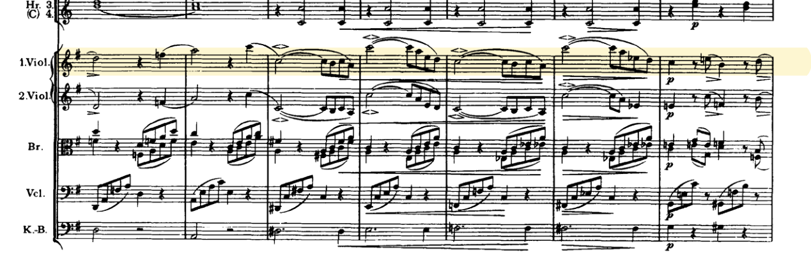
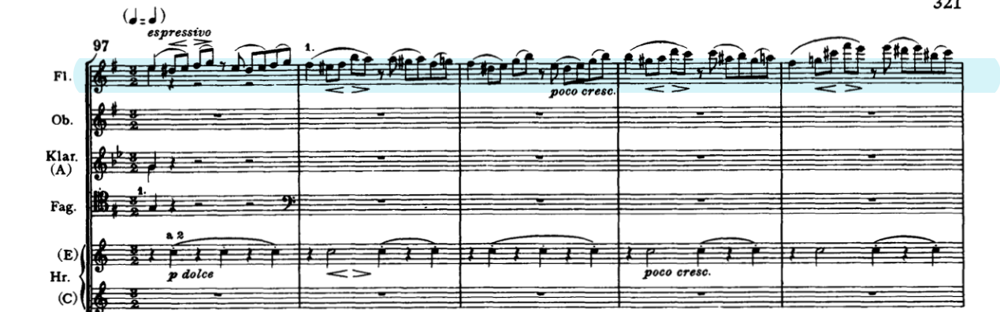

这部交响曲用有限材料建立长程结构。三度细胞、调式轮廓、节奏重音与八小节模型，在不同乐章承担不同工作。

## A 四乐章的整体关系

| 乐章 | 调性与拍号 | 主要组织原则 | 应追踪的变化 |
|---|---|---|---|
| I · Allegro non troppo | e小调，2/2 | 奏鸣曲式与发展变奏 | 三度细胞如何成为长句 |
| II · Andante moderato | E大调，6/8 | 调式引句与奏鸣性回归 | 同一轮廓如何获得新和声 |
| III · Allegro giocoso | C大调，2/4 | 节奏冲击与奏鸣性组织 | 配器、重音和句法如何制造反差 |
| IV · Allegro energico e passionato | e小调，3/4；中段3/2 | 主题、30变奏与扩展尾声 | 固定骨架如何产生交响发展 |

中间乐章扩大了音色和调性的距离。终曲重新确立e小调，最终没有转成E大调凯旋。

## B 第一乐章：主题的身份与形态分离

开头音级链为 **B—G—E—C—A—F♯—D♯—B**。折叠八度后，它形成下降三度链。实际旋律包含上行六度，不能把每个音都描述为下降。

| 位置 | 发生了什么 | 结构意义 |
|---|---|---|
| 弱起与开头 | 短弱起、长落点、旋律休止 | 内声部填补空隙，音乐持续流动 |
| m145起 | 开头貌似重新开始 | 随后转向展开，并非真正再现 |
| m246起 | 木管长时值重述主题，弦乐插句 | 主题先回归，熟悉的织体稍后恢复 |
| m394起 | 三度链转至低弦，声部错位应答 | 尾声重新分配主题的重量 |

第一乐章有440个完整小节，另有弱起。电子谱的441个节点包括这个弱起。

## C 第二乐章：调式记忆进入大调

圆号开头的E—F—G突出降二级F自然。第五小节G♯的出现，则明确大调三度。

| 对照 | 呈示 | 回归 |
|---|---|---|
| 副题位置 | m41，大提琴 | m88，上方弦乐 |
| 起句音级 | B—C♯—D♯—E—D♯—C♯ | E—F♯—G♯—A—G♯—F♯ |
| 调性方向 | B大调 | E大调 |

m113召回调式原型，末尾仍由E—G♯—B确立E大调。全乐章具有弗里几亚色彩，整体并非始终停留在弗里几亚调式。

## D 第三乐章：明亮音色也有重量

二四拍推动音乐向前。短笛和三角铁扩大高音端的亮度，低音大管增强低音端。它承担谐谑性功能，结构却不宜机械套用三拍子谐谑曲与三声中部。

m181的Poco meno presto形成内部减压，m199恢复Tempo I。回归从相当于原m10的材料进入，省略开头的部分宣告。

m247副题相对m52移高纯四度。G调方向在C调中的解决，为奏鸣性读法提供具体证据。

## E 终乐章：八小节秩序与跨周期发展

主题音级为 **E—F♯—G—A—A♯—B—B—E**。第二个B在实际音区低一个八度。模型的来源与巴赫BWV150终曲Ciaccona有关。

| 小节 | 编号 | 关键变化 |
|---|---|---|
| 1—8 | 主题 | 管乐和声陈述；长号已经参与 |
| 9—96 | 变奏1—11 | 脉冲、八分、三连与十六分逐步改变密度 |
| 97—104 | 变奏12 | 三二拍，长笛独奏，仍是小调 |
| 105—128 | 变奏13—15 | E大调展开；m113长号圣咏型段落 |
| 129—248 | 变奏16—30 | 三四拍恢复，主题回归且低音改写 |
| 249—252 | 扩展 | 越出规则八小节核心 |
| 253—311 | 快速尾声 | Più Allegro，压缩与终止性强调 |

编号按主题不计入变奏处理：8＋30×8＋4＋59＝311。详细报告逐一解释全部30个变奏。

“圣咏”在此描述织体与音色，不等于发现了一首教会旋律的直接引用。

## F 两个真实谱面阅读窗口

## G 阅读完整交付文件

[打开全曲深度分析PDF](./Brahms_Op98_全曲深度分析.pdf)

[打开全曲注释总谱PDF](./Brahms_Op98_全曲注释总谱.pdf)

分析报告包括四乐章曲式表、音级与节奏材料、和声、配器、对位、演奏含义，以及真实谱例。

注释总谱保留原始98页，增加一页使用说明。原PDF第1、30、42、68页分别对应四乐章开头。注释版页码比原PDF顺延一页。

黄色标出弦乐观察带，青色标出木管观察带。PDF荧光批注可在支持的阅读器中开关。旁注中的绿色标识和声问题，玫红标识结构问题。

## H 证据与解释的分界

音高、时值和关键声部主要依据用户提供的MuseScore转录核对。原PDF提供完整谱面、版本上下文和乐器标示。

本版属于数字转录校核与分析读本。尚未完成原版逐音视觉校勘；个别转录音符和播放速度标记的疑点已列入报告。页首编号识别不足的总谱页标为“跨页参考段／页界待核”，旁注对应相邻页共同覆盖的段落，不能据此作精确页内定位。

荧光带用于声部定位，不表示带内每个音属于同一主题。曲式边界与跨乐章叙事是分析判断，正文保留必要的分段差异。

巴赫来源关系参考已读取的[荷兰巴赫协会BWV150说明](https://www.bachvereniging.nl/en/bwv/bwv-150)与[Emmanuel Music说明](https://www.emmanuelmusic.org/bach-notes/bwv-150)。这些来源确认历史联系，不替代勃拉姆斯总谱中的逐小节分析。
